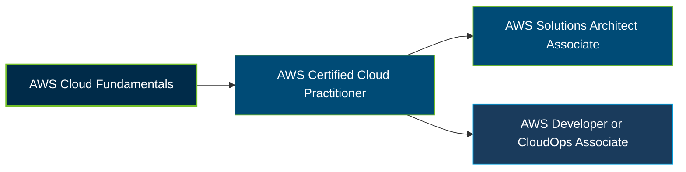

# AWS Certified Cloud Practitioner (CLF-C01) Certification Exam Guide

A dedicated, comprehensive study guide and cloud computing reference repository for candidates preparing for the **AWS Certified Cloud Practitioner (CLF-C01) Certification Exam**.

---

## Exam Overview

The AWS Certified Cloud Practitioner certification validates foundational knowledge of AWS Cloud concepts, core services, security, cloud economics, and terminology. **CLF-C01 is a legacy exam version; AWS currently lists CLF-C02 as the active version.**

- **Exam Format**: Multiple-choice and multiple-response questions
- **Target Audience**: Cloud beginners, students, business professionals, and individuals exploring AWS cloud careers
- **Prerequisites**: No formal prerequisites

---

## Core Exam Domains & Knowledge Areas

### 1. Cloud Concepts

- Benefits of cloud computing, agility, scalability, and elasticity.
- AWS Cloud value propositions and cloud adoption concepts.
- AWS Cloud economics and the AWS Well-Architected Framework.

### 2. Security and Compliance

- AWS shared responsibility model and basic security principles.
- Identity and access management, permissions, and access controls.
- AWS compliance concepts, data protection, and security services.

### 3. Cloud Technology and Services

- AWS global infrastructure, including Regions and Availability Zones.
- Core compute, storage, database, networking, and application services.
- Selecting AWS services for common cloud use cases.

### 4. Billing, Pricing, and Support

- AWS pricing models, billing tools, and cost management.
- AWS Pricing Calculator, cost allocation, and billing reports.
- AWS Support plans, documentation, and technical assistance resources.

---

## Certification Path

This is a suggested learning progression, not a mandatory certification sequence. AWS identifies several Associate-level certifications as possible next steps.

---

## Recommended Practice & Study Resources

Combine official AWS learning materials with foundational cloud study and practical exploration of AWS services.

- **CertsGate**: Explore [CLF-C01 certification preparation resources](https://certsgate.com/exams/amazon/clf-c01) for supplementary study materials and practice questions.
- **Practical AWS Study**: Use the [AWS Skill Builder](https://skillbuilder.aws/) learning platform and AWS documentation to explore core services, cloud security, pricing, and common cloud use cases.
